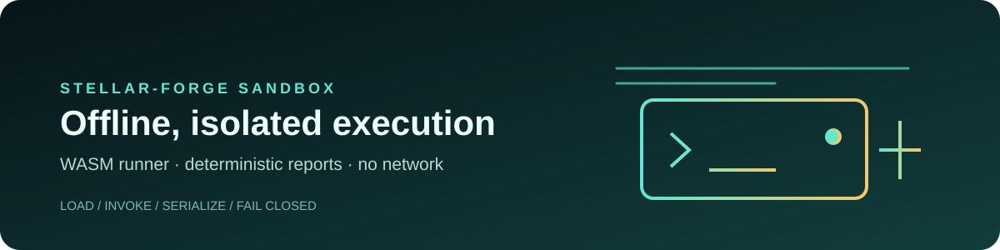

# Stellar-Forge Sandbox Runner



[](https://github.com/StellarForgeDev/stellar-forge-sandbox/actions/workflows/ci.yml)
[](https://github.com/StellarForgeDev/stellar-forge/blob/main/LICENSE)
[](https://www.rust-lang.org/)
[](https://github.com/StellarForgeDev/stellar-forge/blob/main/ROADMAP.md)

Native Rust executable that loads Soroban contract WASM into an in-process
Soroban `Env`, deploys it, and invokes requested functions. It is the offline,
artifact-backed execution engine behind the Stellar-Forge Playground.

## Repository role

This repository owns the native execution engine. The contracts repository supplies artifact-backed inputs, and the core application invokes this runner from its Playground API.

```text
core Playground API ──JSON──► sandbox-runner ──► isolated Soroban Env
                                      │
                                      └────────► JSON ScVal report
```

## Start here

- [Build and test](#build)
- [Core application](https://github.com/StellarForgeDev/stellar-forge)
- [Contracts and artifacts](https://github.com/StellarForgeDev/stellar-forge-contracts)
- [Roadmap](https://github.com/StellarForgeDev/stellar-forge/blob/main/ROADMAP.md)

## Architecture

The Playground API route spawns the sandbox-runner via `execFile`, pipes a JSON
request over stdin, and parses the JSON response from stdout. The runner
compiles the contract in an isolated Soroban host, mocks constructor auth,
then enforces auth for each subsequent call via `mock_auths`. Results are
JSON-serialized ScVal values.

## Part of Stellar-Forge

This repository is a component of the [Stellar-Forge](https://github.com/StellarForgeDev/stellar-forge)
developer platform. It is consumed as a Git submodule by the
[stellar-forge-contracts](https://github.com/StellarForgeDev/stellar-forge-contracts)
repository.

## Build

```bash
cargo build --release
```

## Test

```bash
cargo test --workspace
```

The integration tests require contract WASM artifacts from the contracts
workspace. They fail closed when those artifacts are missing; a green test run
must therefore include the real artifact-backed execution checks. The sandbox
CI workflow provisions the pinned contracts workspace before running tests.

## Lint

```bash
cargo fmt --all -- --check
cargo clippy --workspace -- -D warnings
```

## License

MIT — see the main [Stellar-Forge](https://github.com/StellarForgeDev/stellar-forge)
repository for the full license text.

## Status and boundaries

The runner is a local execution component. It does not prove Testnet deployment, artifact parity, production readiness, or blockchain behavior by itself. It has no wallet, signing, submission, or network role.

Shared [contributing](https://github.com/StellarForgeDev/stellar-forge/blob/main/CONTRIBUTING.md), [security](https://github.com/StellarForgeDev/stellar-forge/blob/main/SECURITY.md), and [code of conduct](https://github.com/StellarForgeDev/stellar-forge/blob/main/CODE_OF_CONDUCT.md) policies are maintained in the core repository. See the [sandbox commit history](https://github.com/StellarForgeDev/stellar-forge-sandbox/commits/main/) as the changelog.
